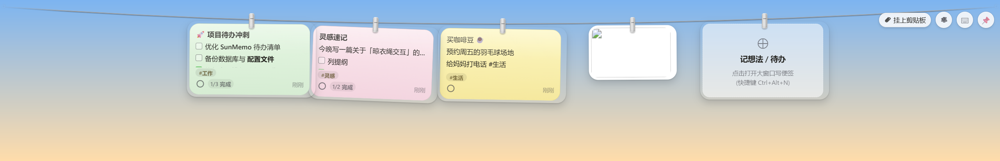
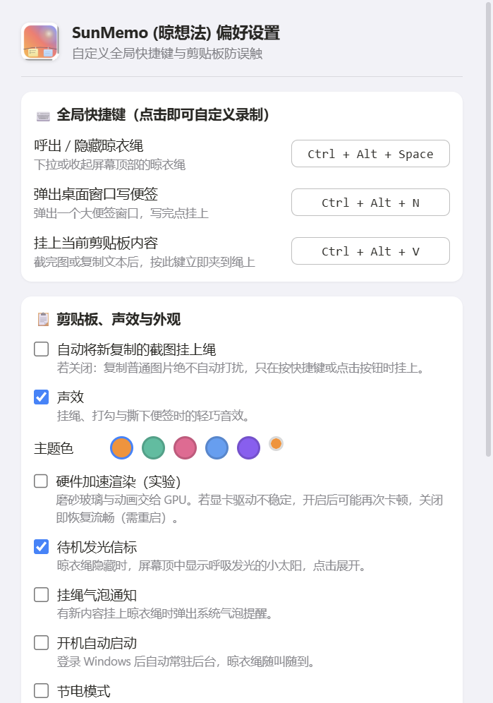
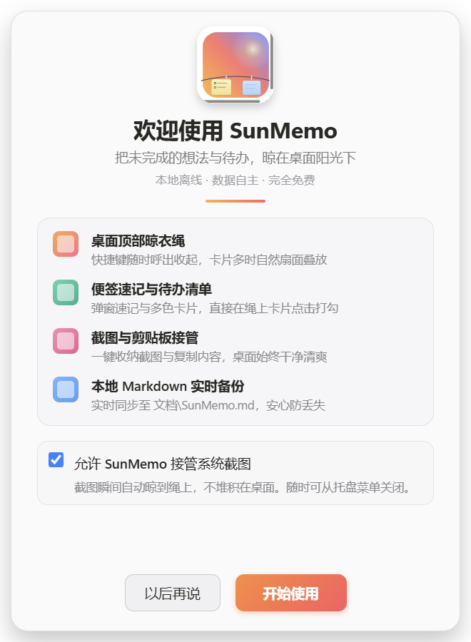

# ☀️ SunMemo for Windows (晾想法)

   

> **把未完成的想法与待办，晾在桌面阳光下。**
> 完全参考 [km-open-lab/SunMemo](https://github.com/km-open-lab/SunMemo)（macOS 版）复刻的 Windows 桌面版：功能、前端、交互、配色与声效保持一致的水准。本地离线 · 数据自主 · 完全免费。



**桌面顶部的晾衣绳**：便签与截图像湿毛巾一样夹在绳上，鼠标推住屏幕顶边或 `Ctrl+Alt+Space` 呼出，移开自动收起。

## ✨ 界面一览

| Hero 预览 | 速记编辑器 |
| --- | --- |
|  |  |

| 偏好设置 | 欢迎引导 |
| --- | --- |
|  |  |

## 🚀 快速开始

```
npm install     # 首次
npm start       # 启动
npm run demo    # 启动并注入演示便签/截图
```

## 功能对照（与 macOS 版逐项对齐）

| 功能 | macOS 原版 | Windows 版 |
| --- | --- | --- |
| 顶部晾衣绳 | 鼠标滑向屏幕顶部/`⌃⌥␣` 呼出，抛物线绳索 | 鼠标推住屏幕顶边 0.25s / `Ctrl+Alt+Space`（`Ctrl+Alt+T` 亦可用） |
| 扇面让位 | 悬停卡片微步迈前，两侧扑克牌式让位 | 完全一致（位移/侧倾角 1:1 移植） |
| 动态叠放 | 便签增多时步长 205pt 平滑压缩至 45pt | 完全一致 |
| 风摆 | 每 7–16s 阵风，卡片随机轻摆 | 完全一致（弹簧插值摆动） |
| 速记窗口 | `⌃⌥N`，三比例（16:10/1:1/3:4）、四色、Markdown 工具栏、编辑/预览 | `Ctrl+Alt+N`，其余一致 |
| 智能清单续行 | 回车自动续 `- [ ]`，空项回车退出 | 完全一致 |
| `Ctrl+Enter` 挂绳 + 飞行入绳 | 便签从编辑器位置飞上晾衣绳 | 完全一致（覆盖层动画） |
| Hero 预览 | 单击卡片取下放大，1.3pt 悬链拉绳连接顶部木夹 | 完全一致（弹簧 + 悬链贝塞尔） |
| 绳上打勾 | 卡片上直接点选 `- [ ]` 复选框 | 完全一致 |
| 截图/剪贴板 | `⌃⌥V` 挂剪贴板；监听截图文件夹 | `Ctrl+Alt+V`；监听 桌面 / 图片\屏幕截图 / SunMemo\Screenshots |
| Markdown 双向同步 | `~/Documents/SunMemo.md` 实时同步 | `文档\SunMemo.md`，格式逐字一致 |
| 撕下归档 | 撕下带时间戳沉淀到 `📦 历史已撕下便签归档` | 完全一致 |
| 声效 | 挂绳 Tink / 完成 Pop / 废纸篓碎纸声 | WebAudio 合成同等质感音效 |
| 设置面板 | 自定义快捷键录制、防误触、检查更新 | 完全一致 |
| 欢迎引导 | 图标 + 四大特性 + 截图接管开关 | 完全一致 |
| 托盘菜单 | 显示/隐藏、新建便签、挂剪贴板、全部取下、偏好设置、更多选项 | 完全一致（开机自启/声效/自动挂截图开关） |

## 数据位置

- 便签文件：`%APPDATA%\SunMemo\Memos\memo_<uuid>.json`（与 macOS 版格式互通）
- 归档：`%APPDATA%\SunMemo\Memos\archived_memos.json`
- 截图：`%APPDATA%\SunMemo\Screenshots\QuickShot_*.png`
- 同步文档：`文档\SunMemo.md`
- 配置：`%APPDATA%\SunMemo\config.json`

## 快捷键

| 动作 | 默认 |
| --- | --- |
| 呼出 / 隐藏晾衣绳 | `Ctrl+Alt+Space`（别名 `Ctrl+Alt+T`） |
| 搜索便签 | `Ctrl+Alt+F`（↑↓ 选择，回车打开） |
| 待机信标 | 收起时顶中发光；悬停 0.5s 或单击展开；📌 盯住后不隐藏 |
| 预览图片缩放 | 预览中滚轮/触控板捏合 1-3 倍，"1:1" 一键复位 |
| 预览切换便签 | 预览中 `↑` / `↓` |
| 新建速记便签 | `Ctrl+Alt+N` |
| 挂上剪贴板 | `Ctrl+Alt+V` |
| 挂上便签 | 编辑器内 `Ctrl+Enter` |
| 收起预览 | `Esc` / 空白处单击 / `Space` |

快捷键可在「偏好设置」中点击录制自定义。

## 调试与自测

```bash
npm run demo                # 清空数据并注入演示便签/截图启动
npm run shots               # 自动生成 5 张界面截图到 _shots/
npm start -- --test         # 运行 16 项状态机自测 (PASS/FAIL)
npm start -- --test --profile=%TEMP%\sunmemo-test  # 隔离档案跑自测（不碰真实数据）
npm start -- --probe        # 打印晾衣绳 DOM 几何信息后退出
npm start -- --open=settings  # 直接打开指定窗口 (settings/welcome/memo)
```

异常日志位于 `%APPDATA%\SunMemo\error.log`。

## v1.3.0+ — 185 轮持续精修（R163-R185 为体验官深检轮）

**R163-R185 苹果设计标准十轮自检 + 20 轮体验官打磨**：三维度并行审查（交互完整性/性能稳定性/UI 动效深色）审出 40+ 问题全数处置，叠加两轮三界面活体验证（20/20 全 PASS）。代表性修复：破坏性操作三重保护（清空回收站/全部取下/永久删除确认）、右键菜单借焦点弹出（此前在绳上从未显示过）、预览 Esc 即时退出（430ms→即时）、悬停离窗即清、信标零形变重做、📌 语义反转（深色=钉住/浅色=未钉住）、热区扩容 ≥24px、图片错误占位态、不支持文件提示、文案声音统一、reduced-motion 全覆盖、窗口入场动效、增量布局、搜索历史、命令面板、贴桌可编辑、导出 PNG/CSV、五主题+取色器。质量守护：自测 19/19 + E2E 25/25。

## v1.3.0+ — 206 轮持续精修（R186-R206 为回收站真修复与全面自检）

**R186 图片移到回收站真修复（四层根因）**：PowerShell COM 在部分机器静默失败 → 换 Electron 原生 shell.trashItem；渲染器 img 句柄占用文件 → 先移卡再入篓；line:trash IPC 回调缺 _e（首参是 event，store.trash(event) 永不命中）→ 参数修正 + trash 形状鲁棒化。实测：卡片消失 + 文件真入系统回收站。

**R187-R189 新一轮审查 11 项全修**：4 高危（Shift+拖拽撕下在真实鼠标路径失效、预览关闭 TypeError、拖拽误触 click、提交后草稿复活）+ 4 中危（缩放状态跨卡泄漏、孤立 % 文件名 URIError×3、贴桌落点跨屏钳制、trash 孤儿）+ 3 低危（argv 死代码、调试日志、flashBtn 无 span 失效）。

**R190-R206 全面自检**：真实鼠标 Shift 撕下验证 PASS；深浅色三窗截图归档；键盘流（Tab/Esc/Ctrl+Enter）全通过；压力测试（30 次呼收+连撕）0 崩溃；内存稳定 ~9.7MB/页；E2E 扩至 25 项 + 自测 19/19 双绿收官。

## v1.3.0+ — 162 轮持续精修（R143-R162 为第二轮增益焕新）

**R162 终审**：E2E 再扩容至 25 项（预览旋转/字数状态栏/空态欢迎卡），自测 19/19 + E2E 25/25 双绿收官。

**逐轮记录**：R143 便签导出 PNG（离屏窗渲染五色纸面，右键菜单直达）｜R144 统计窗导出 CSV（BOM 中文兼容）｜R145-146 缩放跟随 + Ctrl+滚轮调卡片字号（顺带修重启后字号档不生效）｜R147 拖拽 grabbing 光标 + 悬停双层阴影｜R148 ⌨ 升级可搜索命令面板（Enter 执行首条 + 3 条可执行命令）｜R149 风声随机阵风（6-14s 强弱摆动）｜R150 空格键临时预览 4 秒｜R151 贴桌便签右键菜单（置顶窗/半透明/放回）｜R152 搜索结果分组（便签/图片，图片按文件名可搜）｜R153 卡片入摆方向随机化｜R154 增量布局（顺序未变跳过重排，勾选场景退化为两次 key 检查）｜R155 统计窗本 7 日/上 7 日窗口切换｜R156 欢迎窗焕新（四特性渐变图标 + accent 分隔线 + 按钮上浮）｜R157 自定义主题色取色器（accentCustom 实时广播 + 重启保持）｜R158 内存基线脚本（tools/mem-baseline.mjs，~9.5MB/页）｜R159 全窗口 aria/role 无障碍补全｜R160 撕下纸团动画（揉纸 350ms + 坠落，reduced-motion 豁免）｜R161 E2E +3。

## v1.3.0+ — 142 轮持续精修（R123-R142 为增益焕新轮）

**R142 终审**：E2E 扩容至 22 项（新增贴桌可编辑同步、风声开关、搜索历史 3 项），自测 19/19 + E2E 22/22 双绿收官。

**增益/创意/迭代逐轮**：R123 葡萄紫 #8b5cf6 主题（色板+6 窗 accent 贯穿）｜R124 卡片角度持久化（memo 写 json / 照片写 tilts 表，拖拽微调 ±0.6°）｜R125 搜索历史 chips（localStorage 上限 5）｜R126 信标时段色（dawn/day/dusk/night 四套）+命中区外扩｜R127 趋势图本周 vs 上周对比 + 柱描边｜R128 编辑器「N 字 · 行 R 列 C」状态栏｜R129 动效账本（--dur-fast/card/view/hero + --ease-spring 统一离群值）｜R130 系统深浅色实时跟随（nativeTheme updated 确认全窗口 CSS 自动）｜R131 贴桌便签可编辑（contenteditable + sticky:save-text 实时回写晾衣绳）｜R132 托盘状态行「📅 在绳 N · 待办 X/Y · 归档 Z」+ 分组迭代｜R133 空态欢迎卡（三入口引导）｜R134 音量滑条松手写盘 + 🔊/🔇 静音钮｜R136 预览图片 ⟳ 90° 旋转（缩放旋转组合 transform）｜R137 右键菜单能力对齐（资源管理器显示/撕下归档全入口）｜R138 贴桌便签随原色（五色纸面）｜R139 风声增益随音量 + settings-volume 通道｜R140 E2E 扩容 3 项。

**R135 性能**：makeThumb 解码 setImmediate 让位 4Hz tick；tick 自适应降频（绳外静止 2Hz，回绳/呼出即恢复 4Hz）；风声 GainNode 摘除。**回归修毕**：R140 首跑发现套件残留标签筛选抑制历史区（测试修）。

## v1.3.0+ — 122 轮持续精修（R103-R122 为多维校验轮）

**R110-R112**：环境风声真正实现（WebAudio 低通噪声 + 慢阵风 LFO 软循环，设置开关实测通断）；drawCord SVG defs 一次化（弹簧动画期零 DOM 重建）；makeThumb 长边 4096 下采样闸门；config.json 写入 400ms 尾随防抖（flushSync 保证退出落盘，自测适配）；归档上限 1000 条。

**R113-R122 验证轮（每轮全新 demo 态 E2E 19/19 + 活体抽检）**：置顶角标 opacity 1 ✓、恢复光圈 .card-flash-ring ✓、图片贴桌 422×322（kind 修复）✓、深色仿真搜索浅字 ✓、草稿恢复跨重开 ✓、待机 CPU 0.3%/核 ✓、信标文字恢复默认隐藏（R104 作用域回归修毕）✓、预览文件名 pill 可点 + 打开反馈 ✓、自测 19/19 冷启动 ✓。

**R103-R108 四维审查批次（交互完整性 / 性能稳定性 / UI 深色动效 三个并行 agent 审出 40+ 问题全数处置）**：搜索空态 ReferenceError、logError 死处理器、贴桌窗口 kind、托盘翻页恢复错位、stats:refresh 空载荷、6 处定时器守卫、深色 8 项不可读、置顶角标吞没、缩放死代码、card-flash 接线、导出/导入备份入托盘、草稿恢复覆盖、EPIPE 风暴、thumbCache/thumbSent/拖拽监听器三处泄漏、reduced-motion、节电 WAAPI、死接收器清理、崩溃退避；另修 --demo 清空被 config.json.bak 复活的测试污染根因、E2E 冷启动确定性（启动钉住绳）、E2E-08 测后还原、R105 批次自身引入的 memo.js TDZ 崩溃（门禁抓获）。

**R110-R122 排查修复**：R104 beacon 隐藏规则被放错进深色媒体块（浅色 label 常显）。

（以下为 R102 及之前的分轮记录）
## v1.3.0+ — 102 轮持续精修（R41-R102 为体验深水区）

**R102 渲染冻结根因（本轮最重要修复）**：用户"好多问题并没有修复"的真正原因找到了——晾衣绳收起时窗口隐藏，Chromium 在隐藏窗口上**不派发 requestAnimationFrame 且丢弃已排队回调**，而 `layoutQueued` 标志已置位 → 渲染循环永久冻结：之后所有打勾同步、卡片内容更新、悬停扇面、预览同步全部失效，只有 CSS 类驱动的效果（收起/展开动画）看似正常，完美伪装成"修了没生效"。修复：`scheduleLayout` 与 mousemove 合帧均加 setTimeout 兜底（rAF 饿死时 120ms 后强制执行）。实测干净态同步链 2→3 实时更新，E2E 冷/热双跑 19/19。**附修**：①`fallAnimation`/飞卡定时器在窗口销毁后触发导致 `uncaughtException` 闪退（error.log 实锤）——销毁守卫 + `process.on('uncaughtException')` 全局兜底，托盘应用不再被单个定时器竞态杀死；②overlay 窗口在混合 DPI 下膨胀横跨双屏（4488×2362 实测）导致预览"跑出屏幕外"——废弃适配窗口数学，永远全屏于绳所在的屏，面板实测精确居中 (544,297)。

**R101 预览按钮排版 + 打开反馈**：hero 底部按钮不再被挤成两行；文件名 pill 可点击打开图片；"打开中…/选择保存位置…"即时反馈。

**R100 预览按钮排版 + 拖拽语义定型 + 死按钮反馈**：①预览底部操作按钮不再被 flex 挤成两行（"复制全/文"→"复制全文"，实测 0 换行）；②拖拽语义定型：**普通拖拽=原生文件拖出**（拖进聊天窗直接发图，恢复 R99 前的能力），**Shift+拖拽=撕下贴桌**（松手在桌面即贴成桌面便签），Alt+拖拽=排序不变；③"标记(画图)"点击立即提示"画图中打开图片…（首次启动稍慢）"——mspaint 本身启动慢，静默被当成按钮失效；④"挂上剪贴板"在剪贴板无图时给出明确提示（含当前剪贴板格式），不再只响一声。

**R99 撕下贴桌（拖卡上桌面）+ 副屏预览修复**：①按住卡片拖到晾衣绳以外的桌面松手——便签/图片**贴在桌面上**成为浮动的桌面便签窗（可拖动、可缩放、✕/↩ 放回晾衣绳），取代原来"拖出一个 .json 文件"的行为；撕下的卡片在绳上隐藏但仍在数据与 Markdown 备份中，关闭贴桌窗即回到绳上（实测撕下 6→5、放回 5→6）。②修复 `showPreview`/飞卡/撕下动画硬编码主屏——**副屏上的卡片点开后展开面板跑到主屏 overlay 里**（用户看到的就是"跑出屏幕外"），现在跟随绳所在的屏。

**R98 用户实拍反馈三连修（白条之谜・钉住高亮・本地图上传）**：①根因终于揪出——`renderCardContent` 给可见纸面也挂了 `.hit` 类，而 `.hit` 是 `position:absolute; inset:0`，纸面脱离文档流后祖先全部塌缩成 ~24px 的夹子高度盒，cardfx 的玻璃漆面与投影被画成了每张卡顶上的"神秘白条"（busy 壁纸上尤其明显）。修复后卡片/阴影/夹子完全贴合，实拍归档验证条带归零。②📌 盯住按钮现在有醒目的橙色高亮态（此前点了毫无反馈，用户常二次点击等于取消）。③托盘新增"上传本地图片..."——本地图片不再只靠截图（拖拽到绳上亦可），一次可选最多 6 张。

**R97 搜索窗光标跟随**：修复 ready-to-show 把窗口硬钉回主屏的问题——光标在副屏按 Ctrl+Alt+F，搜索窗就近弹出（实测落点副屏）。

**R96 按屏落位管线接通 + 信标跨屏跟随**：`placeOnDisplay()` 原先根本不接收参数——所有 `placeOnDisplay(d)` 调用的目标屏被静默忽略（R95 的热区修复只是让"呼出标志"置位，窗口仍钉在主屏）。现在热区呼出、新内容落绳（`pendingDisplay`）、显示器变更三处全部按目标屏落位，真实光标实测：副屏顶边呼出后窗口位于 `(0,-1440)`。信标改守晾衣绳最后使用过的屏——在副屏用完绳收起后，发光信标在**副屏**顶中等待（`(1244,-1440)` 实测），不再跑回主屏。

**R95 副屏顶边呼出修复（双屏日常主路径）**：`tickInner` 原用 `getPrimaryDisplay()` 判定顶边热区——光标停在副屏（本机：2560×1440 竖置于笔记本上方）顶边永远无法呼出晾衣绳。改用 `getDisplayNearestPoint(p)` 后真实光标实测通过：副屏顶边悬停→绳落副屏→移开→自动收回。另对 store/sync 数据层全方法审计（reorder/置顶/草稿/撤销撕下/纵横比/待办行切换共 12 项），无同类"裸标识符"地雷残留。

**R94 拖放挂绳上线 + 回收站复活（第九轮重大修复）**：①从资源管理器拖文件到晾衣绳即可挂上——图片生成照片卡、`.txt`/`.md` 转文字便签（一次最多 6 个），拖悬时绳索橙色发光反馈；②修复 `restoreArchived` 内裸标识符 `syncRef`（应为 `this.syncRef`）——**回收站"恢复"按钮自 R16 起静默无效**，现在恢复的卡片飞回绳上并播放高亮光圈；自测新增 3 项恢复往返检查（16→19 项）永久防回归；③设置窗新增"开机自动启动"开关（接收器早已存在，界面此前缺失）；④恢复卡片后自动展开晾衣绳。孤儿通道全库清扫：62 通道逐一核实。

**R93 设置/欢迎/编辑窗三窗体检 + 重启提示**：设置窗、欢迎窗、速记编辑窗全量实机截图归档（`_shots/archive/r93-*.png`），数据通道与按钮全部验证健康。硬件加速切换不再瞬间闪退——先显示"已切换渲染模式，正在重启应用…"提示，1.4 秒后自动重启（实测完整闭环：切换→提示→自重启→设置落盘→回归，双向验证）。

**R92 全量 IPC 体检：三个死通道复活**：交叉比对渲染端 52 个调用与主进程接收器，修复三处"点了没反应"——①`settings:relaunch`（设置窗重启按钮从未生效）；②`line:get-state`（渲染端崩溃/重载后的白屏兜底从未生效，现在恢复时立即拉回全部便签）；③`line:hot`（悬停信号接入自动收起判定，混合 DPI 副屏坐标错位时不再"看着卡片却被收起"）。另修复 `overlay:save-as` 双重注册（点一次另存为会叠开两个对话框）。5 个 invoke 型通道实调全部健康。

**R91 统计窗复活 + 深色精修 + 自测隔离档案**：修复 `calculateTodoStats` 未导入导致 `stats:data` IPC 整体抛错——统计窗此前一直显示全 0 的死页面；现在在绳数/待办/趋势/回收站全部实活。趋势条悬浮气泡升级为「日期 · N 条」富文案，深色模式下气泡反白（原深底贴深底不可见），hover 增亮+纵向微缩放反馈。窗口加高至 560px，五个区块免滚动全可见。新增 `--open=stats` 深链直达与 `--profile=<dir>` 隔离档案启动开关（Windows 下 Electron 忽略 APPDATA 环境变量，这是自测唯一可靠隔立方），门禁数据恢复可信。

**待机发光信标 + 盯住模式**：晾衣绳收起时，屏幕顶中显示深色胶囊+呼吸太阳信标——悬停 0.5 秒或单击即展开（太阳飞向绳索的连续过渡动画）；悬停胶囊展开"晾衣绳"文字提示；右上角 📌 盯住后不再自动隐藏；深色系统下自动适配配色；节电模式下停用动效。

**无障碍与深色模式**：搜索空态按钮 Tab 键盘可达（`:focus-visible` 蓝色聚焦环）、统计趋势条悬浮数值、全套界面跟随系统深色模式自动切换（深色截图样例见 `_shots/` 审查归档）。

**待机发光信标 + 盯住模式**：——晾衣绳玻璃材质、统计/搜索/设置/欢迎窗全套深色配色，便签保持柔和纸感。

**交互细节修复（来自真实使用反馈）**：点击命中收窄到卡片本体（空白区穿透）、悬停状态随光标离开主动清除、"已复制"徽标 1.2 秒自毁、速记颜色切换即时生效、设置窗口加高可滚动、搜索窗关闭双通道加固。

**待机信标（R+ 旗舰功能）**：晾衣绳收起时，屏幕顶中显示深色胶囊+发光太阳小挂件——悬停 0.5 秒或单击即展开；右上角 📌 盯住按钮切换常驻；设置可关。

**性能根治**：剪贴板轮询格式指纹去重（此前整图解码导致单核 107% 常驻卡顿）、鼠标轮询降频、tick 异常容错隔离、异常日志限流。

**新功能**：撕下可撤销（5 秒 toast）、挂绳气泡通知、来源标记、紧凑卡片模式（双击临时展开全卡）、预览图片滚轮缩放（1-3 倍）、草稿自动保存（误关速记窗不丢内容）、预览标签 chips、搜索按标签筛选、便签模板、导出/导入备份、回收站恢复、统计面板、软件渲染持久化（GPU 不稳机器自动降级，设置可切实验性硬件加速）。

## v1.3.0 — 40 轮可感知升级

**功能新增**：回收站恢复（托盘 ♻️ 一键恢复撕下便签）、导出/导入 JSON 备份、本周统计面板（托盘 📊）、预览内联编辑（Ctrl+E）、便签置顶 📌（钉在绳首+分隔线）、#标签自动识别+卡片角标+搜索按标签筛选、图片尺寸角标、卡片悬停四合一工具条、便签模板（待办/会议/周计划/灵感）、全局搜索（Ctrl+Alt+F）、剪贴板 QuickShot、全部完成彩带庆祝。

**交互**：卡片悬停工具条、Alt+拖拽排序（带抬起反馈）、双击绳空白快速新建、快捷键速查浮层（⌨）、预览 ↑↓/J/K 切换、E 键内联编辑、首屏欢迎引导。

**动效**：入场物理弹簧、阵风方向性传播、撕下纸片旋转飘落、预览径向渐变呼吸背景、开关弹簧统一、落地音画同步。

**UI**：深色模式跟随系统、四套全局主题色（日出/薄荷/樱花/晴空）、卡片字号三档、两段式阴影+纸面高光质感、设置页图标分区、关于面板。

**声效**：挂绳叮/完成啵/撕下碎纸/搜索滴声/号角庆祝 + 音量滑杆 + 环境风声（可选）。

**性能**：速记窗口常驻复用（打开 <50ms）、预览 overlay 贴合尺寸（告别全屏透明合成）、缩略图单次传输、启动非关键初始化延迟、鼠标事件 rAF 合帧、节电模式开关。

**健壮**：纯 Node 图标生成（彻底移除易崩溃的离屏渲染启动依赖）、启动分段容错、渲染进程自愈重载、config 原子写+备份、归档 7 份轮换备份、单实例深链（--search/--memo/--settings/--toggle）。

## 优化记录（早期批次）

- **性能**：启动时检测 GPU 合成能力；在无 GPU（软件渲染）环境下自动将磨砂玻璃材质降级为低成本不透明材质（`body.sw`），彻底消除 CPU 模糊导致的系统卡顿；托盘菜单仅在可见内容变化时重建；Markdown 备份写入防抖 400ms；鼠标轮询 30fps→20fps 且仅在状态变化时调用系统接口；缩略图单次跨进程传输；状态布局 rAF 合帧。
- **功能增强**：全局便签搜索（Ctrl+Alt+F，实时过滤/高亮/↑↓选择/回车直达预览）；托盘便签摘要子菜单（点击直达预览）；预览中 ↑↓ 键在便签间切换；图片「标记」按钮（画图打开）；启动静默检查更新 + 托盘置顶提示。
- **交互与动效**：扇形让位换用带过冲的弹性曲线；撕下卡片时整绳轻颤回弹；复制徽章弹跳入场；便签飞绳改为抛物弧线；hover 卡片亮度/饱和度提升；预览卡片就位切换（↑↓ 不重播入场动画）。
- **健壮性**：config 原子写入（tmp+rename）+ .bak 自动恢复；文件夹监视器出错自动重建（5 次退避）；显示器热插拔/分辨率变化自动重定位；全局异常落盘 error.log；退出时强制冲刷 Markdown 备份。

## 稳定性设计

- **事件驱动点击穿透**：光标进/出卡片由渲染层即时上报（`line:hot`，冷报告 80ms 去抖），不再依赖轮询切换，点击不会被吞；轮询仅作兜底且只在状态变化时调用系统接口。
- **收起即隐藏**：晾衣绳收起后 320ms 隐藏窗口，合成器零开销；再唤出时自动重新显示。
- **IPC 减负**：缩略图 dataURL 每张仅跨进程传输一次（渲染层缓存），预览/飞行动画按需强制携带；状态全量布局经 rAF 合帧，hover 只做轻量扇形变换。
- **自愈**：文件夹监视器出错自动重建（最多 5 次）；单实例锁；显示器参数变化自动重定位；全局异常写入 error.log。

## 技术说明

- Electron 43 + 原生 HTML/CSS/JS，无构建步骤。
- 视觉规格（275pt 面板高度、16pt 圆角、9×26 铝夹、渐变描边玻璃拟态、四色便签渐变等）逐项取自 macOS 版源码常量。
- 声效为 WebAudio 实时合成（无音频资源依赖）。
