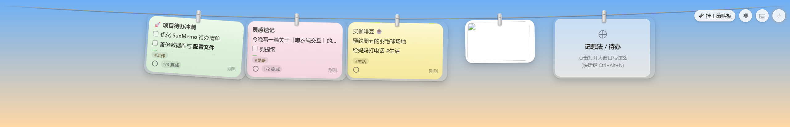
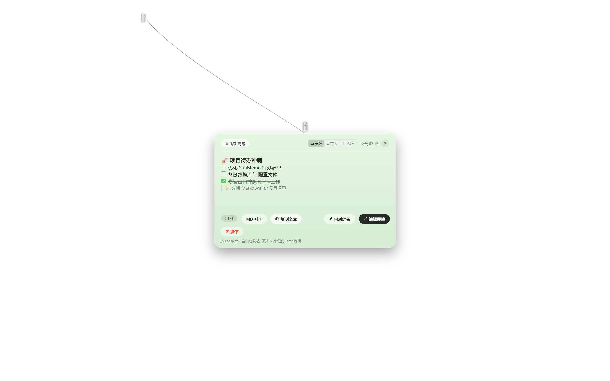
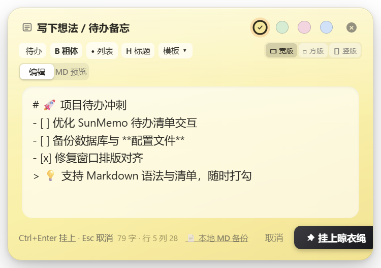

# ☀️ SunMemo for Windows (晾想法)

   

> **把未完成的想法与待办，晾在桌面阳光下。**
> 一条常驻桌面顶部的晾衣绳：便签与截图像湿毛巾一样夹在绳上，随取随用；鼠标推住屏幕顶边或 `Ctrl+Alt+Space` 呼出，移开自动收起。本地离线 · 数据自主 · 完全免费。



## ✨ 核心体验

- **单击取下，悬链放大** —— 点任意卡片，便签沿悬链线弹到屏幕中央成为大图预览，Esc 即时收起
- **智能清单** —— 回车自动续 `- [ ]`，绳上直接打勾，全部完成时撒花庆祝
- **截图/剪贴板接管** —— `Ctrl+Alt+V` 挂上剪贴板；截图落盘即上绳；本地图片可直接拖入或从托盘上传
- **贴桌便签** —— `Shift+拖拽` 把便签贴到桌面：可编辑、置顶窗、半透明，随时放回绳上
- **Markdown 实时备份** —— 全部内容实时同步到 `文档\SunMemo.md`，Obsidian/Typora 随时查看，永不丢数据
- **环境氛围** —— 挂绳 Tink 声、完成 Pop 声、可开关的轻风白噪声、待机时呼吸发光的太阳信标

## 🖼 界面一览

| 卡片预览（悬链放大 + 打勾同步） | 速记编辑器（Markdown 工具栏 + 字数状态栏） |
| --- | --- |
|  |  |

| 本周统计（趋势对比 + CSV 导出 + 回收站） | 偏好设置（六主题 + 取色器 + 快捷键自定义） |
| --- | --- |
|  |  |

<details>
<summary><b>更多界面（点击展开）</b></summary>

| 欢迎引导 | 深色模式（跟随系统） |
| --- | --- |
|  |  |

</details>

## ⌨️ 全局快捷键

| 快捷键 | 功能 |
| --- | --- |
| `Ctrl+Alt+Space` | 呼出 / 收起晾衣绳 |
| `Ctrl+Alt+N` | 弹出速记便签 |
| `Ctrl+Alt+V` | 挂上剪贴板内容 |
| `Ctrl+Alt+F` | 搜索便签 |
| `Esc` | 收起预览 / 收起晾衣绳 |
| `Shift+拖拽卡片` | 撕下贴到桌面 |
| `Alt+拖拽卡片` | 调整顺序 |
| `Ctrl+滚轮` | 调整卡片字号 |

## 🚀 快速开始

```bash
git clone https://github.com/suzike/sunmemo-windows.git
cd sunmemo-windows
npm install
npm start        # 启动
npm run demo     # 启动并注入演示数据
```

要求：Node.js ≥ 18，Windows 10/11。

## 🧪 质量守护

```bash
npm start -- --test          # 状态机自测 19 项
node scripts-e2e.mjs         # 端到端 25 项（需应用运行中）
node tools/mem-baseline.mjs  # 内存基线采样
```

## 📦 版本

见 [CHANGELOG.md](CHANGELOG.md)。当前 v1.4.0。

## 📄 License

MIT
